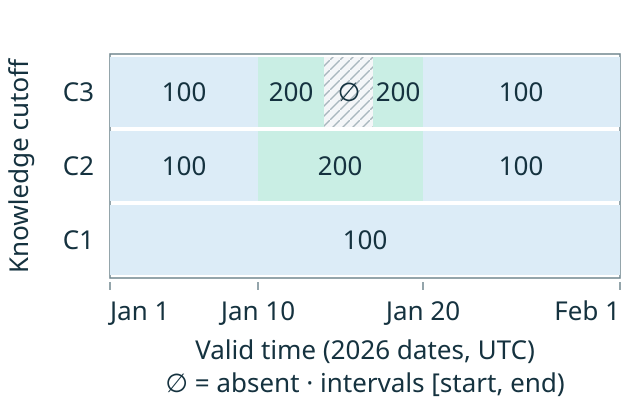

# Bitemporal geometry and indexing

Bitemporal state can be represented in a two-dimensional space: valid time on one
axis and committed knowledge on the other. Generic point, interval and rectangle
indexes can help search that space. The temporal contract supplies the meaning of
corrections, retractions and historical visibility; a geometric datatype supplies
coordinates and search predicates.

This is an indexing research model. MeridianDB currently uses immutable committed
interval snapshots and retained operation history, with eager queries. It has no
Lucene/Solr dependency or specialized multidimensional query index.

## Two axes with different roles

| Model | Coordinates | Additional meaning |
| --- | --- | --- |
| Generic two-dimensional geometry | Two coordinates in chosen domains | Points, regions, containment and intersection under a defined geometry |
| Geographic surface geometry | Often latitude/longitude | Curved-surface topology, longitude wrapping, poles and appropriate distance/area calculations |
| Bitemporal state | Valid instant and committed-knowledge cutoff | Applicability, ordered supersession, retained earlier answers and transaction visibility |

Bitemporal and geospatial models both specialize more general geometric ideas.
Bitemporal state is not a subtype of geographic data. A geographic surface can use
two coordinates while its distance calculation differs from a flat plane; an
implementation may also index it in three dimensions. Geographic queries include
rectangles and polygons as well as radius searches. Temporal queries mainly need
ordered comparisons and interval relationships, rather than a geographic metric.
Query shape and index-cell shape are separate choices: a radius query can use
bounding cells for candidate pruning before checking the geographic relationship.

The axes are asymmetric, but saying that one axis simply takes precedence over
the other is incomplete. For entity `e`, valid instant `v` and cutoff `c`, the
[temporal contract](temporal-contract.md#writes-overlap-and-retraction) selects:

1. Operations for `e` whose commit position is at most `c` and whose valid interval
   contains `v`.
2. The operation with the greatest `(commit position, operation index)` among them.
3. Its put value, or absence for a retraction. No applicable operation also means
   absence.

Knowledge order resolves overlapping applicable assertions. A newer commit does
not replace values outside its valid interval. Equivalently, first select a
committed view, then locate the value within that view's valid-time timeline.
This describes the logical answer; a physical query plan may organize access
differently if it preserves that answer.
The current knowledge coordinate is an ordered commit position, not a wall-clock
timestamp or elapsed-time measure. Calendar-to-cutoff lookup remains unspecified.

## A point query can search a region

The query coordinate `(v, c)` is a point. A resolved version can occupy a region:

```text
v_from <= v < v_to
c_from <= c < c_to
```

That rectangle has **two logical dimensions and four endpoints**. Four endpoint
numbers do not make the temporal model four-dimensional, although an index can
encode them as a four-dimensional point to accelerate suitable inequalities.
Storing only `(valid_from, system_from)` does not describe the version's extent.

These bounds describe logical visibility, not required storage columns. At append
time, a future correction's position is unknown. It may supersede only part of an
older valid interval, producing several effective regions. A single original
assertion need not have one effective `system_to` for its entire valid interval.

## Corrections add knowledge without changing earlier views

Consider one numeric entity. Dates below mean midnight UTC in 2026; intervals
include their start and exclude their end. Commit positions do not denote the
dates on which these writes occurred.

| Commit | Operation | Valid interval |
| --- | --- | --- |
| C1 | Put 100 | `[January 1, February 1)` |
| C2 | Put 200 | `[January 10, January 20)` |
| C3 | Retract | `[January 14, January 17)` |



Each row is one retained view; its visual height has no elapsed-time meaning.
At the same valid date, January 15, C1 returns 100, C2 returns 200 and C3 returns
absence. At January 5, all three return 100. An ordinary rectangle test can locate
a correctly materialized region; constructing and preserving those regions is
part of the temporal system's work.

## Raw assertions and resolved regions need different indexes

An **assertion index** stores original puts/retractions, their valid intervals,
entity identity and committed operation order. Several assertions can cover the
same query point. Candidate lookup must retain enough evidence to resolve which
one wins, including later nonmatching values and retractions.

A **resolved-region index** stores derived visibility regions. It can answer
containment queries more directly, provided those regions encode the exact
temporal contract and are published consistently. Corrections may split regions
and increase index-maintenance work. Old logical answers must remain available
even if an index generation is replaced.

XTDB's documented bitemporal-resolution approach illustrates the first family:
it retains append-only events with valid bounds and system start, then derives
visibility while processing history. This is useful evidence for avoiding eager
maintenance of every effective rectangle, rather than a required MeridianDB
algorithm. The current engine already has its own independently checked contract.

For either representation, keep an assertion's entity, bounds, operation identity
and retraction flag associated. Independently matching multivalued fields must
not combine a valid interval from one assertion with a knowledge interval from
another and present the combination as a real version.

## Lucene and Solr ideas worth evaluating

Sources checked **October 31, 2026**. These are candidate mechanisms, not adopted
dependencies or measured MeridianDB improvements.

| Mechanism | Reusable idea | Temporal condition |
| --- | --- | --- |
| Lucene `LongPoint` | Packed numeric coordinates and multidimensional range filtering | Choose an encoding for the actual assertion or region; preserve coordinate correlation and exact signed values. |
| Lucene `org.apache.lucene.document.LongRange` | Index dimensional min/max pairs and query intersection, containment or within relationships | Effective knowledge bounds must already be correct, or the result is only a candidate set for temporal resolution. |
| Lucene block KD-tree (BKD) | Partition numeric space into bounded cells and skip cells outside a query | Pruning must not lose an overwriting operation or retraction needed to establish the answer. |
| Solr `BBoxField` and recursive spatial prefix trees | Region relationships and hierarchical coarse filtering, with refinement where needed | False-positive candidates can be checked; false negatives cannot be repaired by the resolver. Geographic distance and approximation rules are not temporal semantics. |
| Solr `DateRangeField` | Interval-query vocabulary and calendar-range handling | Its documented millisecond precision does not preserve MeridianDB's microsecond coordinates. Borrow ideas without silently reducing precision. |

The relevant Lucene structures are generic numeric/range facilities beneath
Solr's schema and query layer. Latitude/longitude fields add geographic encoding
and validation that do not fit arbitrary temporal coordinates. Lucene point
indexing also does not store the full result payload automatically; indexed
coordinates and stored result data remain separate layout decisions.

Keep durable entity/request/operation identity separate from Lucene's internal
document numbers, which can change between reader generations. A search update
keyed only by entity must not discard versions still needed by retained cutoffs.

Lucene's `LongPoint` range predicates use inclusive numeric bounds. MeridianDB's
valid intervals are half open, and unbounded endpoints are distinct from finite
`Long.MIN_VALUE`/`Long.MAX_VALUE`. An encoding needs explicit bound handling and
checked arithmetic where endpoints are adjusted; the index must not change that
logical domain by treating ordinary finite values as infinity sentinels.

## Correctness belongs above the geometric primitive

At C2 and January 15, a query for values below 150 must return no row. Filtering
the assertion index down to the older value 100 before resolving visibility would
return an incorrect historical fact. At C3, the retraction must suppress that
older value too. A resolved-region index can support earlier value filtering when
its visibility information proves that filtering is equivalent to resolving
first. The [query-operator contract](../development/temporal-queries.md) owns this
observable behavior.

Queries spanning entities or aggregates must use one pinned committed view.
Lucene provides index commits and near-real-time readers, but those physical
reader generations do not automatically define valid-time history or retain every
database cutoff. An asynchronous derived index needs an explicit query-visible
prefix bound to the authoritative history. A query must not silently read an index
behind its requested cutoff. Recovery, retry identity, index-generation retention
and reader-safe reclamation retain their separate
[persistence obligations](persistence-boundaries.md).

## Compare layouts under the same temporal contract

An entity-first structure ordered by entity and descending committed operation,
with valid-interval lookup or block summaries, is a useful comparator to a global
multidimensional index. Their suitability depends on the workload. Measure:

- Current and historical point lookup for one entity, valid-time interval scans,
  and selection across many entities under selective and broad predicates.
- Shallow and deep correction histories, bounded partial corrections, retractions,
  late valid-time data and repeated values.
- Candidate counts, tail latency, heap/disk use, write amplification, rebuild cost
  and any indexing backlog under equivalent durability and visibility.

Preserve the canonical/reference and seeded answers, full coordinate boundaries,
operation ordering and retry identity. Coordinate encoding and candidate pruning
need dedicated boundary checks in a future implementation. Select a physical
index only after a reproducible workload baseline and measured comparison;
geometric similarity alone does not establish a performance advantage.

## Primary references

- [Lucene 10.6.0 source artifact](https://repo.maven.apache.org/maven2/org/apache/lucene/lucene-core/10.6.0/lucene-core-10.6.0-sources.jar),
  inspected for `LongPoint` and `LongRange`; [Central metadata](https://repo.maven.apache.org/maven2/org/apache/lucene/lucene-core/maven-metadata.xml)
  identifies it as the latest stable artifact at the check date. No dependency is
  selected here; a later Maven change requires fresh version/compatibility research.
- Navigable API references: [LongPoint](https://lucene.apache.org/core/9_12_2/core/org/apache/lucene/document/LongPoint.html),
  [PointValues](https://lucene.apache.org/core/9_12_2/core/org/apache/lucene/index/PointValues.html),
  [BKD package](https://lucene.apache.org/core/9_12_2/core/org/apache/lucene/util/bkd/package-summary.html)
  and [DirectoryReader](https://lucene.apache.org/core/9_12_2/core/org/apache/lucene/index/DirectoryReader.html)
  in the published Lucene 9.12.2 documentation. These reference versions are not a
  recommendation to adopt that older release.
- Solr 10.1 guide: [spatial search](https://solr.apache.org/guide/solr/latest/query-guide/spatial-search.html)
  and [date formatting/ranges](https://solr.apache.org/guide/solr/latest/indexing-guide/date-formatting-math.html).
- XTDB: [bitemporal resolution](https://xtdb.com/blog/building-a-bitemp-index-2-resolution).
